<p align="center">
  
</p>

<h1 align="center">FastSweep</h1>

<p align="center">
  A careful uninstall manager for Windows, with a WinUI 3 look.<br>
  <a href="#english">English</a> · <a href="#français">Français</a>
</p>

<p align="center">
  <a href="https://github.com/Bulls64/FastSweep/actions/workflows/python-app.yml"></a>
  
  
  
  
</p>

---

## English

FastSweep lists the desktop programs and Microsoft Store apps installed on your PC, uninstalls one or several of them in a row, then helps you clean up what they leave behind. Every risky step is backed up, confirmed, or reversible.

<picture>
  <source media="(prefers-color-scheme: dark)" srcset="docs/screenshots/apps-dark-en.png">
  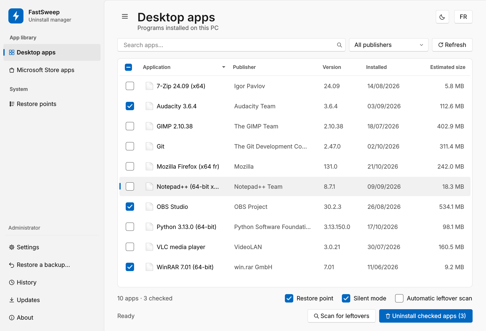
</picture>

### Features

**Inventory**
- Desktop programs read from the registry (per-user and machine-wide, 64- and 32-bit) and Microsoft Store apps shown under their readable names. System packages that cannot be removed are hidden.
- Search by name, publisher, version, folder or package ID, filter by publisher, and sort by any column.
- Estimated size for each app: the value Windows stores when there is one, otherwise the size of the install folder, computed in the background.

**Uninstalling**
- Check several apps and uninstall them in a row, with a progress window. Pending steps can be cancelled at any time.
- An optional restore point is taken before the first change. FastSweep checks that Windows really created it, and stops if it did not.
- **Silent mode**: uninstall without clicking through wizards, using the silent command the program provides or Windows Installer passive mode. Programs without one keep their usual wizard.
- Uninstallers that need administrator rights get the UAC prompt instead of failing.
- FastSweep follows the uninstaller and the processes it starts, then refreshes the list once they are all closed. It also flags MSI codes that ask for a restart.

**Leftover cleanup**
- Registry: matching keys are sorted by confidence. Close matches stay unchecked. Every key is exported to a `.reg` file before deletion, and nothing is deleted if one export fails.
- Files: a shallow scan of the usual folders (AppData, `AppData\Local\Programs`, ProgramData, Program Files, Start menu shortcuts). The items you pick go to the Recycle Bin, never straight to deletion.
- **Automatic leftover scan**: right after an uninstall, or once for a whole queue, FastSweep looks for registry keys and files without asking first. Nothing is deleted until you check it and confirm.
- A saved `.reg` file can be imported back from the sidebar.

**Restore points**
- A dedicated page lists the system restore points, newest first, with search and checkboxes.
- Delete the points you no longer need, or create a new one.
- **Rule-based cleanup**: delete every point older than N days, or keep only the N most recent, with a preview of what will go. The last rule is remembered.
- The most recent point is always protected: it has no checkbox, and FastSweep reads the list again right before deleting so it can never be removed.

**Interface**
- WinUI 3 style, light and dark themes, English and French.
- Acrylic translucency on Windows 11 22H2 and later, with a **background opacity** slider in Settings (0% shows the most of what is behind, 100% makes backgrounds solid; text stays sharp). Older versions keep the same colors on opaque backgrounds.
- A **Settings** page groups theme, language, background opacity, updates and the About section.
- **Updates from GitHub**: FastSweep checks the latest release at startup (can be turned off), or on demand from Settings; the Settings entry lights up when a new version is available. It shows what's new, downloads `FastSweep.exe`, verifies it (size, SHA-256 checksum, file type, GitHub address), swaps it in and restarts. The old version is put back if anything fails. An optional setting installs updates automatically, without asking.
- Local history of every operation, which can be exported to JSON.
- Uninstall options (restore point, silent mode, automatic scan) are remembered between sessions.
- An About section in Settings with the version, license, repository link, a shortcut to report a problem, and a **Copy details** button that puts the version and environment (Windows, Python, Qt) on the clipboard, ready to paste into an issue.

### Screenshots

| | |
| :---: | :---: |
| 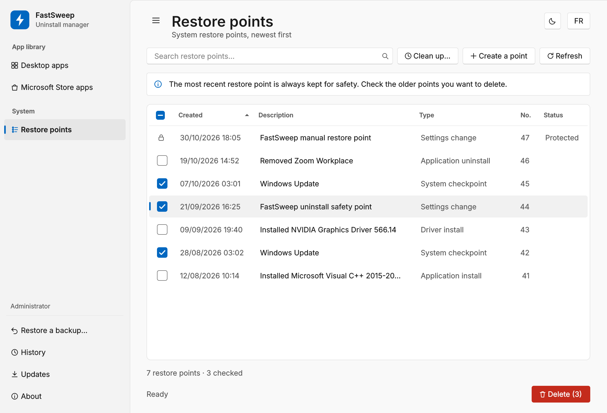 | 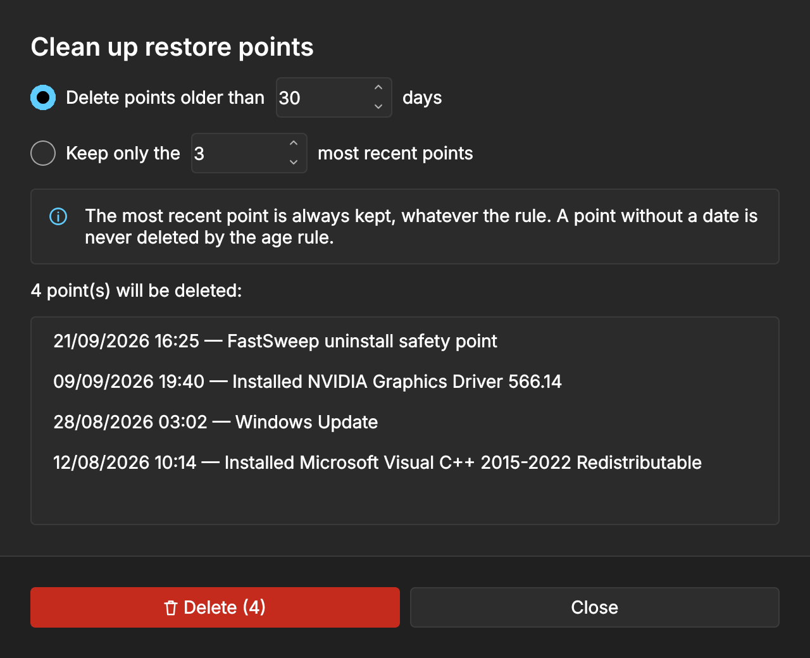 |
| Restore points, newest one protected | Rule-based cleanup with preview |
| 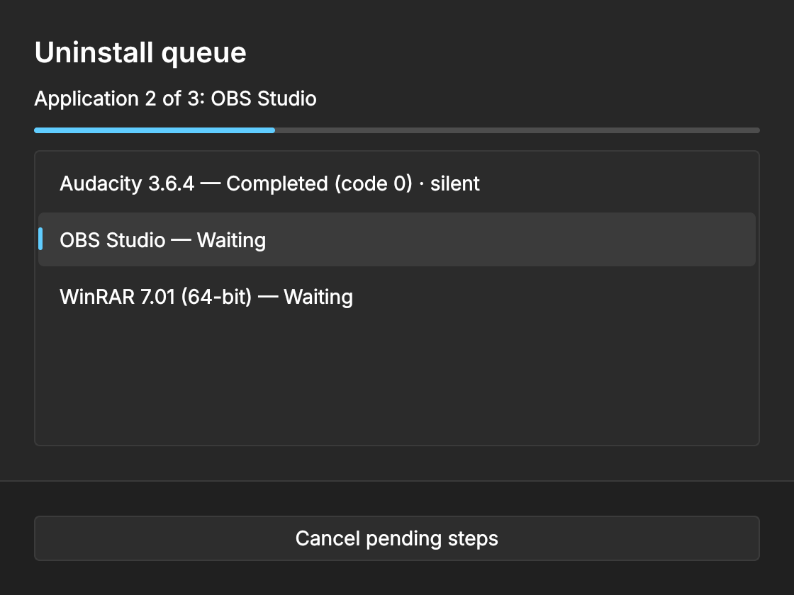 | 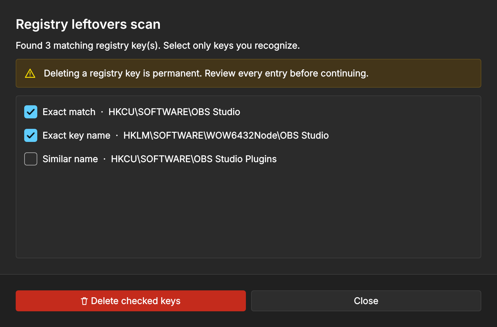 |
| Uninstall queue in silent mode | Registry leftovers, sorted by confidence |
| 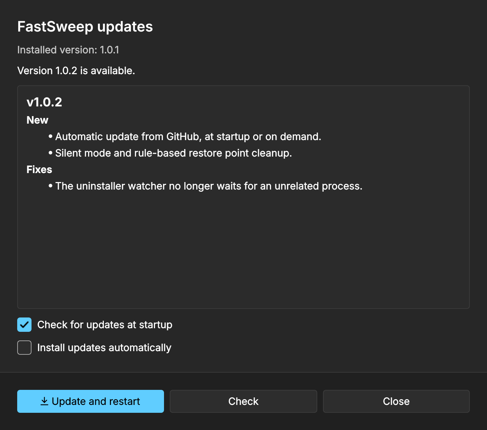 | 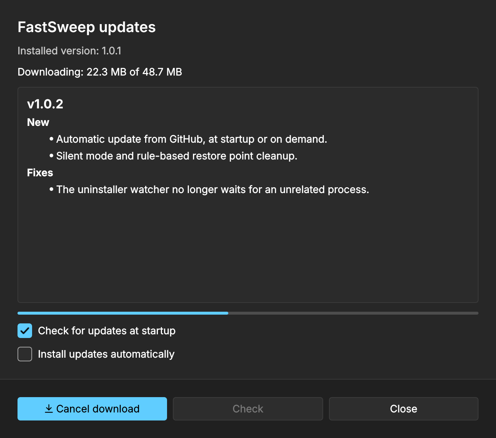 |
| Update available, with release notes | Verified download before installing |
| 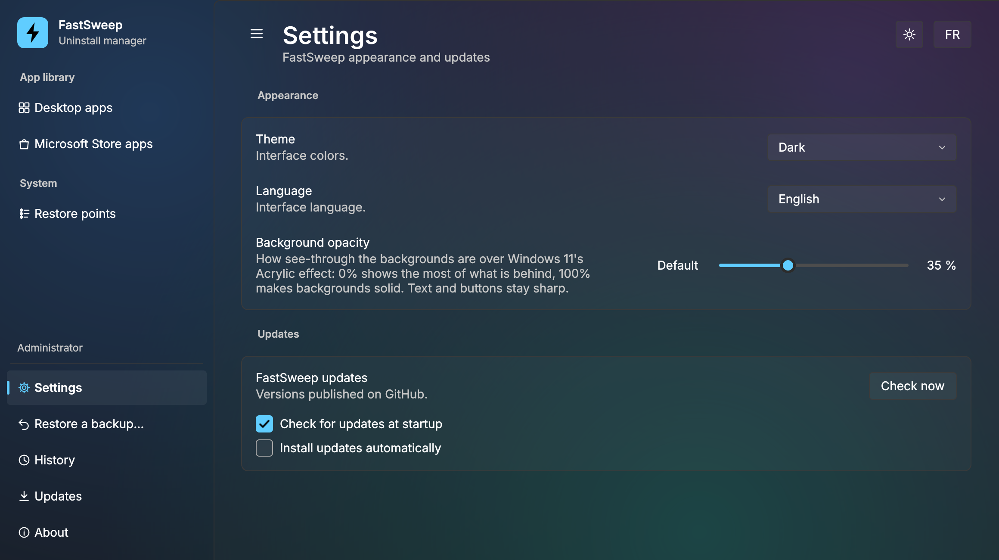 | 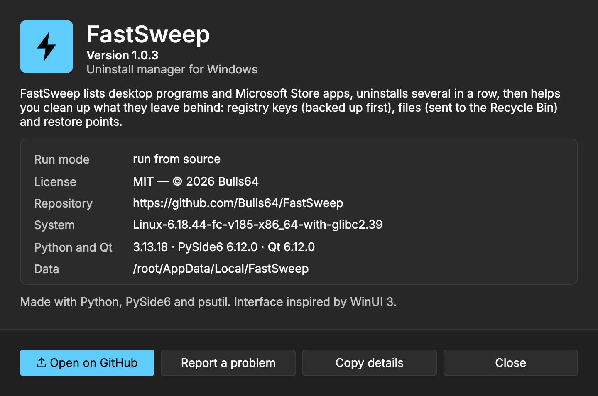 |
| Settings, with the background opacity slider | About section, at the bottom of Settings |

### Requirements

- Windows 10 or 11
- Python 3.10 or later (to run from source)
- Administrator rights for restore points and machine-wide registry keys. The **Relaunch as administrator** button shows the UAC prompt.
- System Protection turned on, for restore points

### Download

`FastSweep.exe` is attached to each [release](https://github.com/Bulls64/FastSweep/releases): download it and run it, no installation needed. Once installed, FastSweep updates itself from these releases (see **Updates from GitHub** above). Only the downloaded executable can replace itself: a copy run from source reports new versions but does not install them, and the update needs write access to the folder holding `FastSweep.exe`.

### Running from source

```powershell
git clone https://github.com/Bulls64/FastSweep.git
cd FastSweep
py -m pip install -r requirements.txt
py main.py
```

### Building the executable

Run `build.bat` by double-clicking it or from a terminal. It checks Python, installs the dependencies and PyInstaller if needed, runs the tests, then builds `dist\FastSweep.exe`. Use `build.bat --sans-tests` to skip the tests.

`build.ps1` does the same thing (`-SansTests` to skip the tests). If PowerShell refuses to run it because it is not signed, use `build.bat` or `powershell -ExecutionPolicy Bypass -File .\build.ps1`.

### Keyboard shortcuts

| Key | Action |
| --- | --- |
| `Ctrl+F` | Search |
| `F5` | Refresh the current page |
| `Space` | Check or uncheck the selected rows |
| `Del` | Uninstall the checked apps, or delete the checked restore points |

### Where FastSweep keeps its data

| What | Where |
| --- | --- |
| Registry backups (`.reg` + `manifest.json`) | `%LOCALAPPDATA%\FastSweep\RegistryBackups` |
| Operation history | `%LOCALAPPDATA%\FastSweep\history.json` |

### Tests

```powershell
py -m unittest discover -s tests -v
```

### Project layout

| Path | Role |
| --- | --- |
| `main.py` | Entry point |
| `fastsweep/inventory.py` | Registry and Store inventory, icons, sizes |
| `fastsweep/uninstall.py` | Uninstallers, UAC fallback, process tracking, restore point creation |
| `fastsweep/cleanup.py` | Registry and file leftovers, backups, Recycle Bin |
| `fastsweep/restore_points.py` | Listing and deleting restore points, protection of the newest |
| `fastsweep/updater.py`, `update_ui.py` | Update from GitHub releases: lookup, verified download, executable swap; update window |
| `fastsweep/about.py` | About section of Settings |
| `fastsweep/settings_page.py` | Settings page |
| `fastsweep/window.py`, `restore_page.py`, `dialogs.py` | Interface |
| `fastsweep/widgets.py`, `theme.py`, `glyphs.py`, `backdrop.py` | WinUI components, themes, icons, Acrylic |
| `fastsweep/i18n.py` | English and French texts |
| `tests/` | Unit and interface tests |

### License

FastSweep is released under the [MIT License](LICENSE).

---

## Français

FastSweep liste les programmes classiques et les applications Microsoft Store installés sur votre PC, en désinstalle un ou plusieurs à la suite, puis vous aide à nettoyer ce qu'ils laissent derrière eux. Chaque étape risquée est sauvegardée, confirmée ou réversible.

<picture>
  <source media="(prefers-color-scheme: dark)" srcset="docs/screenshots/apps-dark-fr.png">
  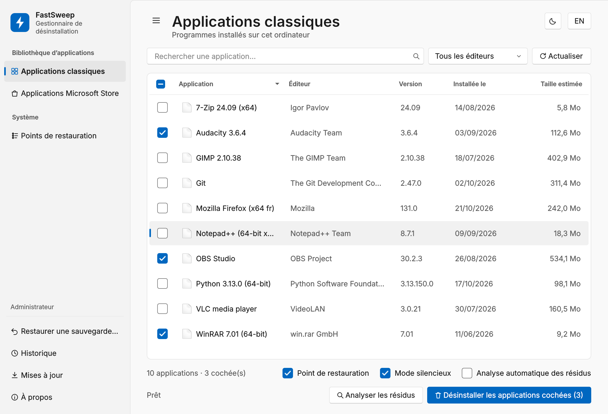
</picture>

### Fonctions

**Inventaire**
- Programmes classiques lus dans le registre (par utilisateur et pour tout l'ordinateur, en 64 et 32 bits) et applications Microsoft Store affichées sous leur nom lisible. Les packages système non supprimables sont masqués.
- Recherche par nom, éditeur, version, dossier ou identifiant de package, filtre par éditeur et tri sur toutes les colonnes.
- Taille estimée de chaque application : la valeur enregistrée par Windows quand elle existe, sinon la taille du dossier d'installation, calculée en arrière-plan.

**Désinstallation**
- Cochez plusieurs applications et désinstallez-les à la suite, avec une fenêtre de progression. Les étapes en attente peuvent être annulées à tout moment.
- Un point de restauration facultatif est créé avant la première modification. FastSweep vérifie que Windows l'a vraiment créé et s'arrête sinon.
- **Mode silencieux** : désinstallez sans cliquer dans les assistants, grâce à la commande silencieuse fournie par le programme ou au mode passif de Windows Installer. Les programmes qui n'en ont pas gardent leur assistant habituel.
- Les désinstalleurs qui exigent les droits administrateur affichent l'invite UAC au lieu d'échouer.
- FastSweep suit le désinstalleur et les processus qu'il lance, puis actualise la liste une fois qu'ils sont tous fermés. Il signale aussi les codes MSI qui demandent un redémarrage.

**Nettoyage des résidus**
- Registre : les clés correspondantes sont classées par confiance, et les noms seulement proches restent décochés. Chaque clé est exportée dans un fichier `.reg` avant suppression, et rien n'est supprimé si un export échoue.
- Fichiers : analyse peu profonde des dossiers habituels (AppData, `AppData\Local\Programs`, ProgramData, Program Files, raccourcis du menu Démarrer). Les éléments choisis vont dans la Corbeille, jamais directement à la suppression.
- **Analyse automatique des résidus** : juste après une désinstallation, ou une seule fois pour toute une file, FastSweep cherche les clés de registre et les fichiers sans poser de question. Rien n'est supprimé tant que vous ne l'avez pas coché et confirmé.
- Un fichier `.reg` sauvegardé peut être réimporté depuis le volet latéral.

**Points de restauration**
- Une page dédiée liste les points de restauration du système, du plus récent au plus ancien, avec recherche et cases à cocher.
- Supprimez les points dont vous n'avez plus besoin, ou créez-en un nouveau.
- **Nettoyage par règle** : supprimez tous les points de plus de N jours, ou ne gardez que les N plus récents, avec un aperçu de ce qui partira. La dernière règle est mémorisée.
- Le point le plus récent est toujours protégé : il n'a pas de case, et FastSweep relit la liste juste avant de supprimer pour qu'il ne puisse jamais être effacé.

**Interface**
- Style WinUI 3, thèmes clair et sombre, français et anglais.
- Transparence Acrylic sous Windows 11 22H2 et plus récent, avec un curseur **d'opacité des fonds** dans les Réglages (0 % laisse le plus voir l'arrière-plan, 100 % rend les fonds pleins ; le texte reste net). Les versions plus anciennes gardent les mêmes couleurs sur des fonds opaques.
- Une page **Réglages** regroupe le thème, la langue, l'opacité des fonds, les mises à jour et la section « À propos ».
- **Mises à jour depuis GitHub** : FastSweep cherche la dernière release au démarrage (désactivable) ou à la demande depuis les Réglages ; l'entrée « Réglages » s'allume quand une nouvelle version est disponible. Il affiche les nouveautés, télécharge `FastSweep.exe`, le vérifie (taille, somme SHA-256, type de fichier, adresse GitHub), le remplace et se relance. L'ancienne version est remise en place si quelque chose échoue. Un réglage facultatif installe les mises à jour automatiquement, sans rien demander.
- Historique local de toutes les opérations, exportable en JSON.
- Les options de désinstallation (point de restauration, mode silencieux, analyse automatique) sont mémorisées d'une session à l'autre.
- Une section « À propos » dans les Réglages, avec la version, la licence, le lien vers le dépôt, un raccourci pour signaler un problème et un bouton **Copier les informations** qui place la version et l'environnement (Windows, Python, Qt) dans le presse-papiers, prêts à coller dans un ticket.

### Captures d'écran

| | |
| :---: | :---: |
| 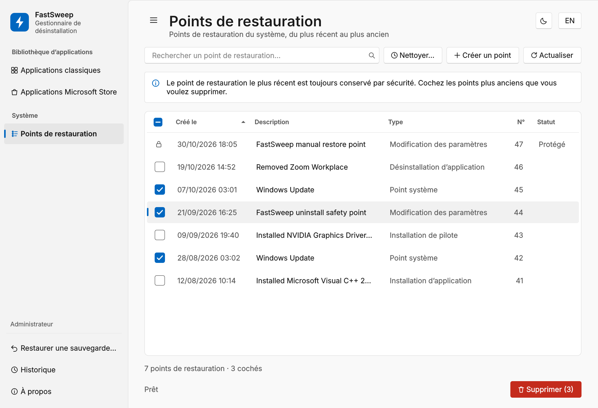 | 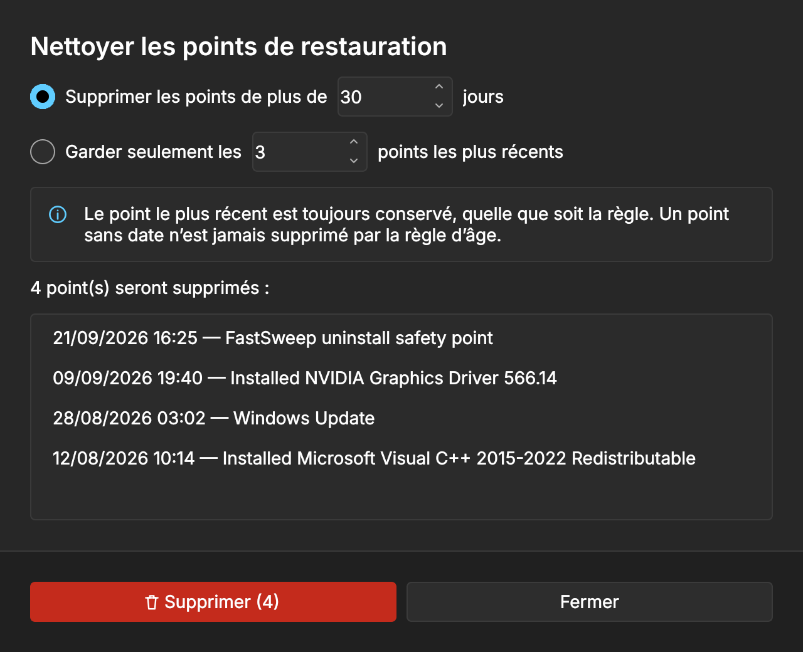 |
| Points de restauration, le plus récent protégé | Nettoyage par règle avec aperçu |
| 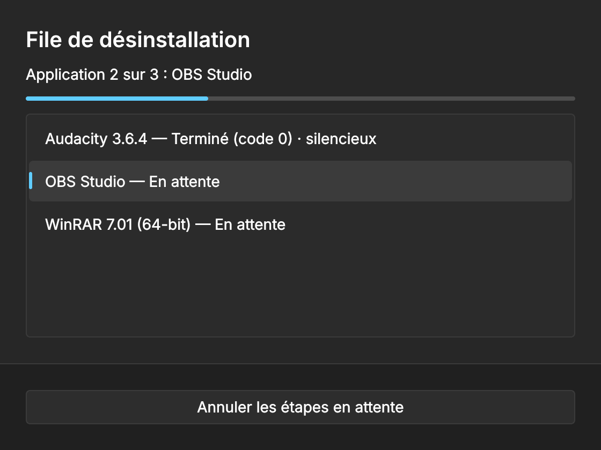 | 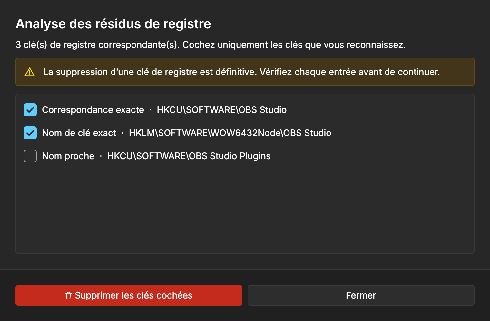 |
| File de désinstallation en mode silencieux | Résidus de registre classés par confiance |
| 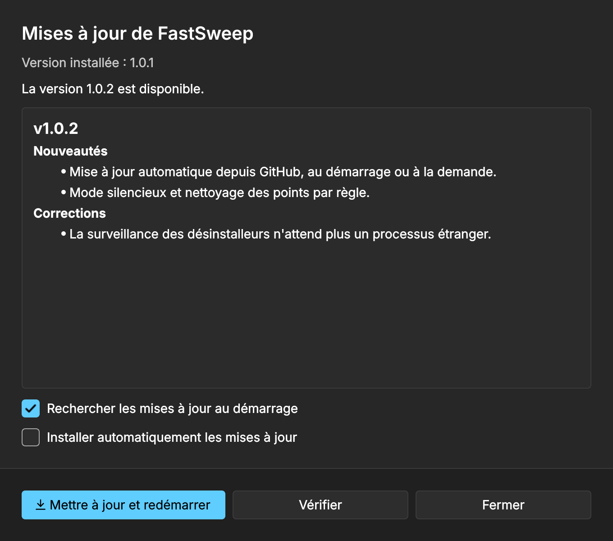 | 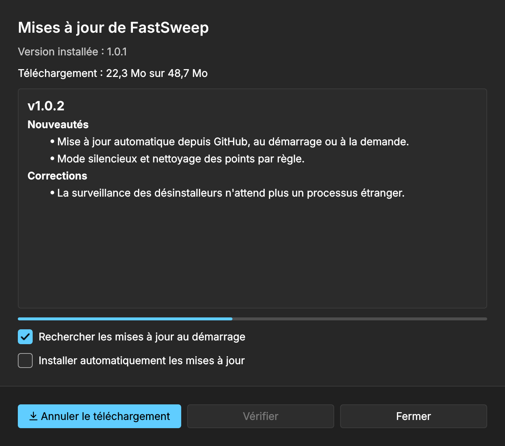 |
| Mise à jour disponible, avec les nouveautés | Téléchargement vérifié avant installation |
| 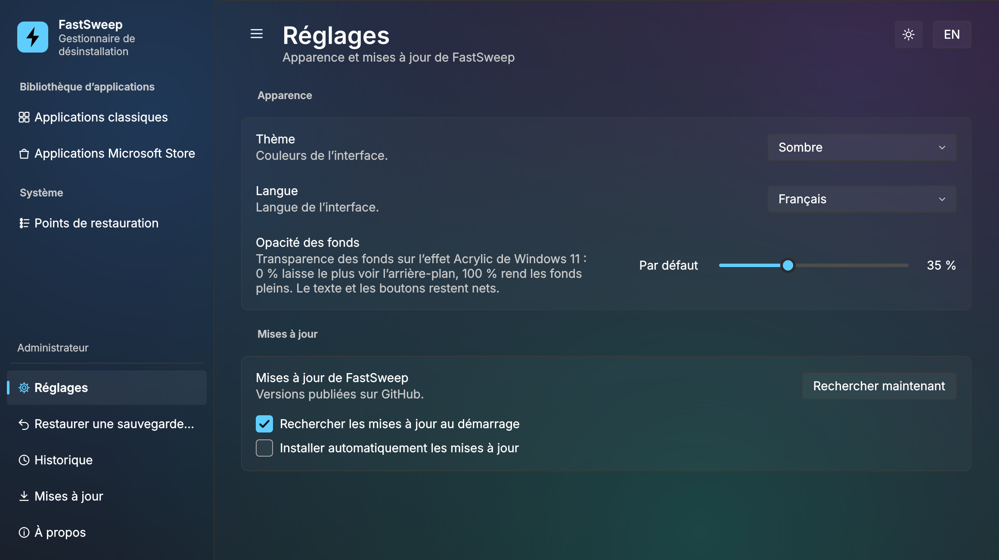 | 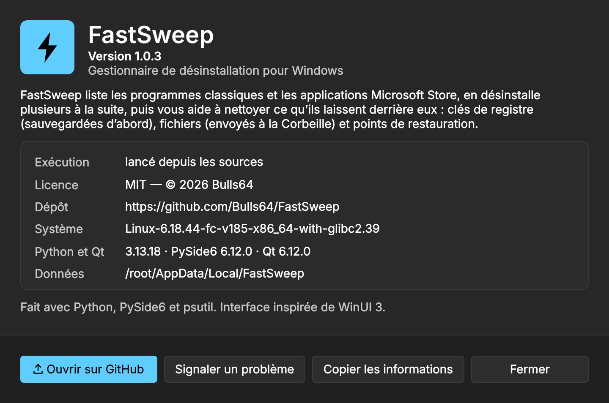 |
| Réglages, avec le curseur d'opacité des fonds | Section « À propos », en bas des Réglages |

### Configuration requise

- Windows 10 ou 11
- Python 3.10 ou plus récent (pour lancer depuis les sources)
- Droits administrateur pour les points de restauration et les clés de registre de l'ordinateur. Le bouton **Relancer en administrateur** affiche l'invite UAC.
- Protection du système activée, pour les points de restauration

### Téléchargement

`FastSweep.exe` est joint à chaque [release](https://github.com/Bulls64/FastSweep/releases) : téléchargez-le et lancez-le, sans installation. Ensuite, FastSweep se met à jour tout seul depuis ces releases (voir **Mises à jour depuis GitHub** ci-dessus). Seul l'exécutable téléchargé peut se remplacer lui-même : une copie lancée depuis les sources signale les nouvelles versions sans les installer, et la mise à jour demande l'accès en écriture au dossier qui contient `FastSweep.exe`.

### Lancer depuis les sources

```powershell
git clone https://github.com/Bulls64/FastSweep.git
cd FastSweep
py -m pip install -r requirements.txt
py main.py
```

### Construire l'exécutable

Lancez `build.bat`, par double-clic ou dans un terminal. Il vérifie Python, installe au besoin les dépendances et PyInstaller, lance les tests, puis construit `dist\FastSweep.exe`. `build.bat --sans-tests` saute les tests.

`build.ps1` fait la même chose (`-SansTests` pour sauter les tests). Si PowerShell refuse de le lancer parce qu'il n'est pas signé, utilisez `build.bat` ou `powershell -ExecutionPolicy Bypass -File .\build.ps1`.

### Raccourcis clavier

| Touche | Action |
| --- | --- |
| `Ctrl+F` | Rechercher |
| `F5` | Actualiser la page affichée |
| `Espace` | Cocher ou décocher les lignes sélectionnées |
| `Suppr` | Désinstaller les applications cochées, ou supprimer les points de restauration cochés |

### Où FastSweep range ses données

| Quoi | Où |
| --- | --- |
| Sauvegardes du registre (`.reg` + `manifest.json`) | `%LOCALAPPDATA%\FastSweep\RegistryBackups` |
| Historique des opérations | `%LOCALAPPDATA%\FastSweep\history.json` |

### Tests

```powershell
py -m unittest discover -s tests -v
```

### Organisation du code

| Chemin | Rôle |
| --- | --- |
| `main.py` | Point d'entrée |
| `fastsweep/inventory.py` | Inventaire du registre et du Store, icônes, tailles |
| `fastsweep/uninstall.py` | Désinstalleurs, repli UAC, suivi des processus, création des points de restauration |
| `fastsweep/cleanup.py` | Résidus du registre et des fichiers, sauvegardes, Corbeille |
| `fastsweep/restore_points.py` | Lecture et suppression des points de restauration, protection du plus récent |
| `fastsweep/updater.py`, `update_ui.py` | Mise à jour depuis les releases GitHub : recherche, téléchargement vérifié, remplacement de l'exécutable ; fenêtre de mise à jour |
| `fastsweep/about.py` | Section « À propos » des Réglages |
| `fastsweep/settings_page.py` | Page Réglages |
| `fastsweep/window.py`, `restore_page.py`, `dialogs.py` | Interface |
| `fastsweep/widgets.py`, `theme.py`, `glyphs.py`, `backdrop.py` | Composants WinUI, thèmes, icônes, Acrylic |
| `fastsweep/i18n.py` | Textes français et anglais |
| `tests/` | Tests unitaires et d'interface |

### Licence

FastSweep est distribué sous [licence MIT](LICENSE).

---

<p align="center">Bulls64</p>
